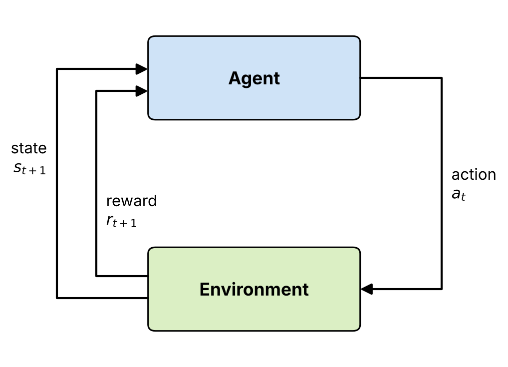
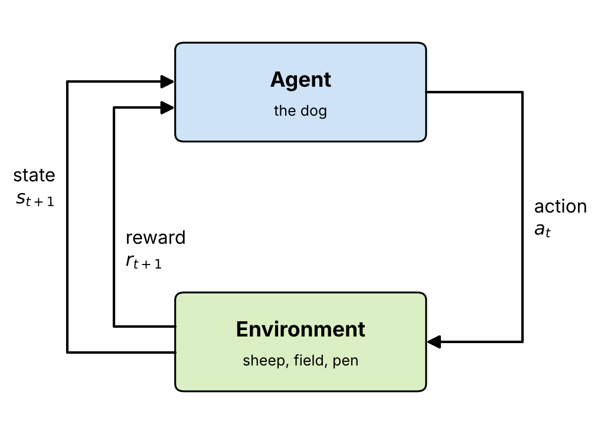

# Introduction

## Rule-based agents

- In this course you built agents that follow rules: boids, El Farol bar goers
- That works when **we** know the rules
  - But where do those rules come from?
  - Smart organisms are not born with them. They **learn** them from experience
  - Some rules are hard to write down!
- Reinforcement learning: the agent learns what to do **from rewards alone**

## Task 1, variant 1: get the sheep in the pen {.smaller}

:::: {.columns}

::: {.column width="55%"}
<video data-autoplay loop muted src="images/herding1.mp4" style="max-height: 480px; max-width: 100%;"></video>
:::

::: {.column width="45%"}
- The field is a grid of 8 x 8 cells, with a pen of 2 x 2 cells in the top-right corner
- The sheep follows rules: it flees when a dog is within 2 cells, and otherwise it mostly grazes
- One or two dog. Each dog can stay, or move up, down, left or right
- The episode ends when the sheep is in the pen
:::

::::

## Task 1, variant 2: get the sheep in, and keep it there {.smaller}

:::: {.columns}

::: {.column width="55%"}
<video data-autoplay loop muted src="images/herding2.mp4" style="max-height: 480px; max-width: 100%;"></video>
:::

::: {.column width="45%"}
- Now the pen is in the middle of the field, and it is open on all sides
- The sheep can walk in, but it can also walk out again
- The task never ends
:::

::::

## Task 2: balancing a ball on a board {.smaller}

:::: {.columns}

::: {.column width="55%"}
<video data-autoplay loop muted src="images/ballonboard.mp4" style="max-height: 480px; max-width: 100%;"></video>
:::

::: {.column width="45%"}
- Two agents hold a round board
- 9 actions: height (low, middle, high) x rotation (backward, neutral, forward)
- The movements are noisy, and bigger movements are noisier
- An agent sees the ball's position and velocity, but not what the other agent does
:::

::::

## Caveat
- We do *not* do the full theory (e.g., why and when these methods converge)
- The goal for today: understand **what the code does**, and why
- If you get lost: there is a **cheat sheet** (link at the bottom of every slide)

{width="55%"}


# Minimal foundations: The mathematical framework of RL

## The reinforcement learning loop

At every step, the agent and the environment take turns:

1. The agent sees the **state** $s_t$ of the environment
2. The agent chooses an **action** $a_t$
3. The environment changes to a new state $s_{t+1}$, and gives the agent a **reward** $r_{t+1}$

The goal of the agent is not to get the biggest reward right now, but the biggest **total reward over time**. We call this total the **return**.

- In the herding task, the dog is the agent. The sheep, the field and the pen are the environment
- The dog gets a small penalty for every step, and a big reward when the sheep is in the pen

## The Markov property

> The future depends only on the present and not on the past.

$$P(s_{t+1} \mid s_t) = P(s_{t+1} \mid s_1, s_2, \dots, s_t)$$

- The **state** should tell you everything you need to know about what happens next
- Example from case 2: The ball's current position and velocity determines next state
- RL works when you can engineer a state that is Markov enough

## Markov chain

Imagine a ball on a table. The wind pushes the ball around a bit. 

| Current state | Next state | Transition probability |
|---|---|---|
| center | center | 0.8 |
| center | north | 0.1 |
| center | east | 0.1 |
| center | south | 0.0 |
| center | west | 0.0 |

- This is a **Markov table**: it gives the probability of the next state, given the current state
- There is no agent that decides anything here, so the ball only moves because of the wind


## The reinforcement learning loop {.smaller}

{width="30%"}

At every step, the agent and the environment take turns. The agent sees the **state** $s_t$ and chooses an **action** $a_t$. The environment then changes to a new state $s_{t+1}$, and gives the agent a **reward** $r_{t+1}$.

The goal of the agent is not to get the biggest reward right now, but the biggest **total reward over time**. We call this total the **return**.

## The loop in the herding task {.smaller}

{width="30%"}

- The dog is the agent. The sheep, the field and the pen are the environment
- The dog sees where the sheep is (the state), and moves (the action)
- The dog gets a small penalty for every step, and a big reward when the sheep is in the pen

## Our mini herding world

We use a corridor of 5 cells, with one dog (D), one sheep (S), and the pen (P) at the end.

| 1 | 2 | 3 | 4 | 5 |
|:-:|:-:|:-:|:-:|:-:|
| D | . | S | . | P |

The dog is our agent: it learns what to do. The sheep is part of the **environment**, just like the corridor and the pen, and it follows these rules:

| Situation | What the sheep does | Probability |
|---|---|---|
| The dog is right next to the sheep | it steps away from the dog | 1 |
| The dog is not next to the sheep | it stays and grazes | 0.8 |
| | it wanders one step left | 0.1 |
| | it wanders one step right | 0.1 |

The episode ends when the sheep is in the pen.

## MDP element 1: states $S$ {.smaller}

| 1 | 2 | 3 | 4 | 5 |
|:-:|:-:|:-:|:-:|:-:|
| D | . | S | . | P |

- A state describes the environment the dog sees: $s$ = (dog position, sheep position)
- In the picture, the state is $s = (1, 3)$
- The set of states $S$ contains all combinations of positions:

| | sheep in 1 | sheep in 2 | sheep in 3 | sheep in 4 | sheep in 5 (pen) |
|:-:|:-:|:-:|:-:|:-:|:-:|
| **dog in 1** | x | (1, 2) | **(1, 3)** | (1, 4) | (1, 5) |
| **dog in 2** | (2, 1) | x | (2, 3) | (2, 4) | (2, 5) |
| **dog in 3** | (3, 1) | (3, 2) | x | (3, 4) | (3, 5) |
| **dog in 4** | (4, 1) | (4, 2) | (4, 3) | x | (4, 5) |
| **dog in 5** | (5, 1) | (5, 2) | (5, 3) | (5, 4) | x |

- The dog and the sheep cannot be in the same cell (x), so there are $5 \times 5 - 5 = 20$ states

## MDP element 2: actions $A$

| 1 | 2 | 3 | 4 | 5 |
|:-:|:-:|:-:|:-:|:-:|
| D | . | S | . | P |

- The dog can do three things: $A$ = {left, stay, right}
- The dog cannot walk off the corridor, and it cannot walk into the sheep
- The sheep here have no actions in the MDP: it is part of the environment

## MDP element 3: transition probability $P^a_{ss'}$

This is the Markov table again, but now the next state also depends on the **action** of the dog.

| Current state $s$ | Action $a$ | Next state $s'$ | $P^a_{ss'}$ |
|:-:|:-:|:-:|:-:|
| `D . S . P` (1, 3) | stay | `D . S . P` (1, 3) | 0.8 |
| `D . S . P` (1, 3) | stay | `D S . . P` (1, 2) | 0.1 |
| `D . S . P` (1, 3) | stay | `D . . S P` (1, 4) | 0.1 |
| `D . S . P` (1, 3) | right | `. D . S P` (2, 4) | 1 |

- If the dog stays, it is not next to the sheep, so the sheep mostly grazes
- If the dog steps right, it is next to the sheep, so the sheep always steps away
- For each state and action, the probabilities add up to 1

## Returns

The agent wants the biggest total reward over time: the **return**. The simplest version just adds up all rewards:

$$R_t = r_{t+1} + r_{t+2} + r_{t+3} + \dots$$

This gives two problems.

## Problem 1: what if the task never ends?

In variant 2 the dog gets +1 for every step the sheep is in the pen, and the task never ends.

- A dog that always keeps the sheep in gets $1 + 1 + 1 + \dots = \infty$
- A dog that keeps the sheep in only half of the time **also** gets $\infty$
- So we cannot compare the two dogs anymore

## Problem 2: now or later?

Imagine two dogs in variant 1, without the step penalty:

- Dog A pens the sheep after 2 steps: return $= 10$
- Dog B pens the sheep after 200 steps: return $= 10$

Both get the same return, but dog A is clearly better.

## MDP element 5: the discount factor $\gamma$

We give rewards that come later a smaller weight:

$$R_t = r_{t+1} + \gamma r_{t+2} + \gamma^2 r_{t+3} + \dots = \sum_{k=0}^{\infty} \gamma^k r_{t+k+1}$$

With $\gamma = 0.9$, the weights are:

| step | 1 | 2 | 3 | 10 | 50 |
|:-:|:-:|:-:|:-:|:-:|:-:|
| weight $\gamma^k$ | 1 | 0.9 | 0.81 | 0.39 | 0.006 |


- Problem 1 is solved: $1 + 0.9 + 0.81 + \dots = 10$, so the return is finite again
- Problem 2 is solved: dog A gets $0.9 \times 10 = 9$, dog B gets almost 0
- $\gamma = 0$: only the next reward counts. $\gamma$ close to 1: the far future counts too

## Policy

- The policy $\pi$ says what action to perform in each state
- $\pi(s) : S \rightarrow A$
- It can be a lookup table. Our goal: find the policy that gives the highest return

## State value function

How good is it for the agent to **be** in state $s$, if it follows policy $\pi$?

$$V^{\pi}(s) = \mathbb{E}_{\pi}\left[R_t \mid s_t = s\right]$$

- The expected return, starting from $s$
- It depends on the policy: a bad dog makes every state look bad

## State-action value function (Q function)

How good is it to **do** action $a$ in state $s$, and then follow policy $\pi$?

$$Q^{\pi}(s, a) = \mathbb{E}_{\pi}\left[R_t \mid s_t = s, a_t = a\right]$$

A Q table for the mini world could look like this:

| State | Action | Value |
|:-:|:-:|:-:|
| (1, 3) | left | 7.5 |
| (1, 3) | stay | 8.1 |
| (1, 3) | right | 8.9 |

## Why Q and not V?

- With $V$ you know how good each state is. But to choose an action, you need to know **where each action leads** ($P^a_{ss'}$): a map
- With $Q$ the consequence of each action is already in the table: just pick the action with the highest value.
- So if we do **not** know $P^a_{ss'}$, we can learn $Q$, and thereby also the best policy $\pi^*(s) = \arg\max_a Q(s, a)$

## Where are we?

So far we have described the herding task as an **MDP**:

- the states $S$, the actions $A$, the transition probabilities $P^a_{ss'}$, the rewards $R^a_{ss'}$, and the discount factor $\gamma$

The goal of the dog is to find the **policy** $\pi$ that gives the highest **return**. To find it, we want to know how good each state ($V$) or each action in a state ($Q$) is. If we know $Q$, the best policy is easy: in every state, pick the action with the highest $Q$ value.

So the question is: how do we compute $V$ or $Q$?

If we know the **entire MDP** (so also $P^a_{ss'}$ and $R^a_{ss'}$), we can compute them exactly, using the **Bellman equation**.

## The Bellman equation

The value of a state = the reward now + the discounted value of where you end up next

$$V^{\pi}(s) = \sum_a \pi(s, a) \sum_{s'} P^a_{ss'}\left[R^a_{ss'} + \gamma V^{\pi}(s')\right]$$

$$Q^{\pi}(s, a) = \sum_{s'} P^a_{ss'}\left[R^a_{ss'} + \gamma \sum_{a'} \pi(s', a') Q^{\pi}(s', a')\right]$$

- An infinite sum (the return) becomes a relation between **neighbouring** states
- If we know $P^a_{ss'}$ and $R^a_{ss'}$, we can solve it (dynamic programming, not covered)

## The Bellman equation is nested {.smaller}

The return already has a nested structure. Each return contains the next return:

$$R_t = r_{t+1} + \gamma \big(r_{t+2} + \gamma \big(r_{t+3} + \gamma \big(\dots\big)\big)\big) = r_{t+1} + \gamma R_{t+1}$$

The Bellman equation uses the same trick for values. You can read it from the outside in:

$$V^{\pi}(s) = \underbrace{\sum_a \pi(s, a)}_{\text{what the dog does}} \; \underbrace{\sum_{s'} P^a_{ss'}}_{\text{what the sheep does}} \Big[\underbrace{R^a_{ss'}}_{\text{reward now}} + \gamma \underbrace{V^{\pi}(s')}_{\text{the same equation again}}\Big]$$

- The value of $s$ depends on the value of $s'$, which depends on the value of $s''$, and so on
- So we never have to add up the whole future at once: each state only needs to "look" one step ahead

## Finding the best policy with Bellman {.smaller}

For the **best** policy, the dog does not average over its actions, but takes the best one. This is the **Bellman optimality equation**:

$$V^*(s) = \max_a \sum_{s'} P^a_{ss'}\left[R^a_{ss'} + \gamma V^*(s')\right]$$

If we know $P^a_{ss'}$ and $R^a_{ss'}$, we can find $V^*$ step by step (**value iteration**):

1. Start with $V(s) = 0$ for every state
2. Update every state with the equation above, using the current values of the next states
3. Repeat until the values stop changing

Then the best policy is: in every state, pick the action with the highest value

$$\pi^*(s) = \arg\max_a \sum_{s'} P^a_{ss'}\left[R^a_{ss'} + \gamma V^*(s')\right]$$

- In the mini world, the dog learns that stepping right in $(1, 3)$ is worth $8.9$, more than staying

## Bellman in the mini world

The dog is in cell 1, the sheep in cell 3, and the dog steps right. We use $\gamma = 0.9$. From $(2,4)$ the dog will pen the sheep in the next step, so $V(2,4) = 10$:

$$Q((1,3), right) = 1 \times [-0.1 + 0.9 \times 10] = 8.9$$

- With a random sheep there would be more next states, and we would weight each one by its probability

## But what if we do not know $P^a_{ss'}$ and $R^a_{ss'}$?

- Real dogs do not know how the sheep will react
- So we **estimate** the values from experience: try things, and see what happens
- That is reinforcement learning
- Two ways today:
  - **Monte Carlo**: play a whole episode, and look back
  - **Temporal difference (TD)**: learn after every step

## Remember Intro to AI2 from year 1!

- Let an agent **wander randomly** through a grid world (many episodes)
- For every (state, action): compute the **reward-to-go** (= the return $R_t$)
- Average them: the **Q table** (of the random policy!)
- Then act **greedily**: always the action with the highest value

What went wrong? The agent sometimes kept bumping into the same wall:

- It only learned from random wandering, and never **while acting**
- It never **explored** anymore once it acted greedily

## Current methods -> Exploration: epsilon-greedy

- **Greedy**: always pick the action with the highest Q value so far
- But maybe there is a better action we never tried
- **Epsilon-greedy**: with probability $\epsilon$ a random action, otherwise the best one

```python
def epsilon_greedy_policy(state, epsilon):
    if random.uniform(0, 1) < epsilon:
        return random_action()                                  # explore
    else:
        return max(actions, key=lambda a: Q[(state, a)])        # exploit
```

- We use this in **both** methods today

# Method 1: Monte Carlo

## Monte Carlo: play, then look back

- Play a **whole episode** with epsilon-greedy
- At the end, compute the return $R_t$ for every step
- Update $Q(s, a)$ towards the return. In our notebooks, a running average:

$$Q(s, a) \leftarrow Q(s, a) + \alpha\,(R_t - Q(s, a))$$

- **First visit**: if $(s, a)$ occurs several times in an episode, only the first time counts
- **On-policy**: we learn about the policy we follow, exploration included

## Monte Carlo in the mini world (1)

Same episode, $\gamma = 0.9$. We compute the returns **backwards**: $R_t = r_{t+1} + \gamma R_{t+1}$

| $t$ | $(s_t, a_t)$ | $r_{t+1}$ | $R_t$ |
|:-:|:-:|:-:|:-:|
| 2 | ((2, 4), right) | +10 | 10 |
| 1 | ((1, 3), right) | -0.1 | $-0.1 + 0.9 \times 10 = 8.9$ |
| 0 | ((1, 3), left) | -0.1 | $-0.1 + 0.9 \times 8.9 = 7.91$ |

- Steps close to the success get a high return, steps far away a lower one

## Monte Carlo in the mini world (2)

All Q values start at 0, $\alpha = 0.1$:

| $(s, a)$ | update | new $Q(s, a)$ |
|:-:|:-:|:-:|
| ((2, 4), right) | $0 + 0.1\,(10 - 0)$ | 1.0 |
| ((1, 3), right) | $0 + 0.1\,(8.9 - 0)$ | 0.89 |
| ((1, 3), left) | $0 + 0.1\,(7.91 - 0)$ | 0.791 |

- Note: "left" (bumping into the wall) also got credit, because the episode ended well
- Only over many episodes does this average out

## Monte Carlo: what it needs

- An **end** of the episode: only then do we know the return
- Notebook 1: the pen in the corner, plus a maximum of 200 steps (otherwise an untrained dog may wander for a very long time)
- During an episode, the dog learns **nothing**. It only remembers what it did

# Method 2: TD learning with SARSA

## Bellman as an estimate

Recall: value now = reward + discounted value next. We do not know the true values, but we have our **estimates**:

$$V(s) \leftarrow V(s) + \alpha\,\big(r + \gamma V(s') - V(s)\big)$$

- $r + \gamma V(s')$: **one real step**, plus an estimate of the rest
- $r + \gamma V(s') - V(s)$: the **TD error**. Was it better or worse than we expected?
- We do not wait for the end: we learn after **every step**

## SARSA

The same idea for Q. It uses **S**tate, **A**ction, **R**eward, next **S**tate, next **A**ction:

$$Q(s, a) \leftarrow Q(s, a) + \alpha\,\big(r + \gamma Q(s', a') - Q(s, a)\big)$$

- $a'$ is the action we will **really** do next (chosen with epsilon-greedy)
- So SARSA is **on-policy**, like our Monte Carlo
- No episodes needed. That is why it works for variant 2 (the pen in the middle, no end)

## SARSA in the mini world {.smaller}

Variant 2: the pen is in the **middle** (cell 3). $+1$ for every step the sheep is in the pen, $-0.1$ when it is outside. No end.

| 1 | 2 | 3 | 4 | 5 |
|:-:|:-:|:-:|:-:|:-:|
| D | S | P | . | . |

- $s = (1, 2)$, $a$ = stay. The dog is next to the sheep, so it steps into the pen: $r = +1$, $s' = (1, 3)$
- Epsilon-greedy picks $a'$ = stay. Current values: $Q((1,2), stay) = 0.2$, $Q((1,3), stay) = 0.5$

$$Q((1,2), stay) = 0.2 + 0.1\,\big(1 + 0.9 \times 0.5 - 0.2\big) = 0.2 + 0.1 \times 1.25 = 0.325$$

- Note: if the dog now steps right, it pushes the sheep out again. The dog has to learn to **stay back**

## Monte Carlo versus SARSA {.smaller}

| | Monte Carlo | SARSA (TD) |
|---|---|---|
| Learns | at the end of an episode | after every step |
| Target | the real return $R_t$ | $r + \gamma Q(s', a')$: one real step + an estimate |
| Needs an end? | yes | no |
| Uses its own estimates? | no | yes (bootstrapping) |

## Briefly: the board task with SARSA

- **State**: the ball's position and velocity (x, y, vx, vy), each cut into 7 bins: $7^4 = 2401$ states
- **Actions** per hand: 3 heights $\times$ 3 rotations = 9
- **Reward**: closer to the center is better, $-1$ when the ball falls off
- Exactly the same SARSA update. Each hand has its own Q table, and does not see the other hand

# What we are missing

## Central versus independent learning

- **Central**: one Q table for both agents, with joint actions: $Q(s, a_1, a_2)$
- **Independent**: one Q table per agent: $Q_1(s, a_1)$ and $Q_2(s, a_2)$. The other agent is part of the environment
  - But that environment keeps changing (the other one learns too): **non-stationarity**
- See the extra notebook (notebook 3)

## Off-policy learning, and beyond {.smaller}

- **Q learning** (off-policy): learns about the *best* behaviour, while exploring

$$Q(s, a) = Q(s, a) + \alpha\,\big(r + \gamma \max_{a'} Q(s', a') - Q(s, a)\big)$$

- **Function approximation and deep RL**: a neural network instead of a table (deep Q networks)
- **Continuous actions**: actor-critic methods
- **Model-based approaches**: learn a model of the world, and plan with it


## Cheat sheet {#cheat-sheet}

<style>
.reveal #cheat-sheet h2 { font-size: 40px !important; margin-bottom: 8px; }
.reveal #cheat-sheet table, .reveal #cheat-sheet p { font-size: 18px !important; }
.reveal #cheat-sheet table { width: 100%; margin: 0 0 12px 0; table-layout: auto; }
.reveal #cheat-sheet col { width: auto !important; }
.reveal #cheat-sheet td, .reveal #cheat-sheet th { padding: 1px 6px !important; }
.reveal #cheat-sheet td:first-child { white-space: nowrap; }
.reveal #cheat-sheet thead { display: none; }
.reveal #cheat-sheet p { margin: 3px 0 !important; }
.reveal #cheat-sheet table { margin-bottom: 8px !important; }
</style>

::: {style="text-align: right; margin-top: -60px; margin-bottom: 20px;"}
<a href="javascript:void(0)" onclick="backFromCheatSheet()">back to where you were</a>
:::

:::: {.columns}

::: {.column width="50%"}

**The MDP**

| | |
|---|---|
| $s$, $s'$ | the state now, the next state |
| $a$, $a'$ | the action now, the next action |
| $r$ | the reward after an action |
| $P^a_{ss'}$ | transition probability: from $s$ to $s'$ with action $a$ |
| $R^a_{ss'}$ | reward for going from $s$ to $s'$ with action $a$ |
| $\gamma$ | discount factor: how much future rewards count (0 to 1) |
| $\pi(s)$ | policy: what action to do in state $s$ |

**Terms**

| | |
|---|---|
| Episode | one run from start to end (e.g. until the sheep is in the pen) |
| Episodic / continuous | with / without a terminal state |
| On-policy | learn about the policy you follow (Monte Carlo, SARSA) |
| Off-policy | learn about the best policy while exploring (Q learning) |
| Bootstrapping | using your own estimate $Q(s',a')$ instead of the real future |
| Central / independent | one Q table for all agents / one Q table per agent |

:::

::: {.column width="50%"}

**The learning rules**

| | |
|---|---|
| Epsilon-greedy | random action with probability $\epsilon$, otherwise the best one |
| Monte Carlo | $Q(s,a) = Q(s,a) + \alpha\,(R_t - Q(s,a))$, after the episode |
| TD prediction | $V(s) = V(s) + \alpha\,(r + \gamma V(s') - V(s))$, every step |
| SARSA | $Q(s,a) = Q(s,a) + \alpha\,(r + \gamma Q(s',a') - Q(s,a))$, every step |
| Q learning | $Q(s,a) = Q(s,a) + \alpha\,(r + \gamma \max_{a'} Q(s',a') - Q(s,a))$ |
| TD error | $r + \gamma Q(s',a') - Q(s,a)$: better or worse than expected? |
| $\alpha$ | learning rate: how far we move towards the target |

**Values and returns**

| | |
|---|---|
| Return | $R_t = r_{t+1} + \gamma r_{t+2} + \gamma^2 r_{t+3} + \dots$ (in the notebooks: G) |
| Backwards | $R_t = r_{t+1} + \gamma R_{t+1}$ |
| State value | $V^{\pi}(s)$: how good is it to **be** in $s$ |
| Q value | $Q^{\pi}(s, a)$: how good is it to **do** $a$ in $s$ |
| Bellman | value now = reward + $\gamma$ value next |

:::

::::

<script>
// remember the last slide before the cheat sheet, so the link above can jump back to it
(function () {
  let last = null;
  function setup() {
    Reveal.on('slidechanged', function (e) {
      if (e.previousSlide && e.previousSlide.id !== 'cheat-sheet') {
        last = Reveal.getIndices(e.previousSlide);
      }
    });
    window.backFromCheatSheet = function () { if (last) { Reveal.slide(last.h, last.v); } };
  }
  if (window.Reveal && Reveal.isReady && Reveal.isReady()) { setup(); }
  else { window.addEventListener('load', function () { Reveal.on('ready', setup); if (Reveal.isReady()) setup(); }); }
})();
</script>